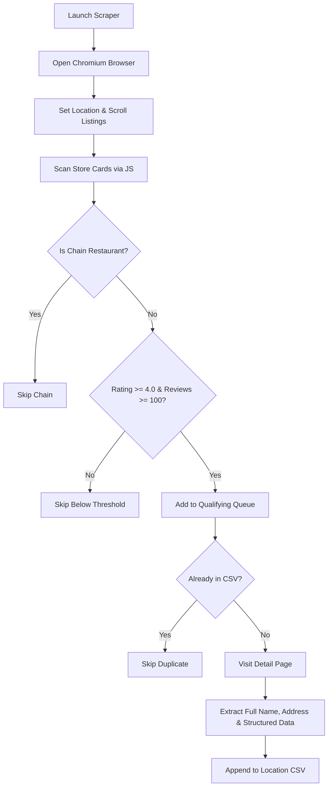

# 🍽️ UberEats Restaurant Scraper & Lead Extractor

[](https://www.python.org/downloads/)
[](https://playwright.dev/python/)
[](https://opensource.org/licenses/MIT)
[](ubereats_data/)

A robust, production-ready Python web scraping and data extraction engine powered by **Playwright**. Designed to extract local, high-quality, independent restaurants from UberEats while automatically filtering out major fast-food chains and low-volume listings.

Ideal for **B2B lead generation**, **food & hospitality market research**, **competitive intelligence**, and **restaurant database aggregation**.

---

## 📑 Table of Contents

- [Key Features](#-key-features)
- [How It Works](#-how-it-works)
- [Repository Structure](#-repository-structure)
- [Prerequisites](#-prerequisites)
- [Installation & Setup](#-installation--setup)
- [Usage Guide](#-usage-guide)
  - [1. Diagnostic Pre-flight Check](#1-diagnostic-pre-flight-check)
  - [2. Multi-Location Interactive Launcher](#2-multi-location-interactive-launcher)
  - [3. Direct Scraper Execution](#3-direct-scraper-execution)
  - [4. Selector Debugger](#4-selector-debugger)
- [Output Data Schema](#-output-data-schema)
- [Filtering & Customization](#-filtering--customization)
  - [Quality Thresholds](#quality-thresholds)
  - [Chain Restaurant Filtering](#chain-restaurant-filtering)
- [Troubleshooting](#-troubleshooting)
- [Ethical Scraping & Disclaimer](#-ethical-scraping--disclaimer)

---

## 🌟 Key Features

- **🛡️ Chain Restaurant Exclusion**: Automatically identifies and filters out 150+ major national fast-food and casual dining chains (e.g., McDonald's, Starbucks, Subway, Domino's, Chick-fil-A, Taco Bell) using fuzzy string and substring matching.
- **⭐ Strict Quality Thresholds**: Configurable quality filters requiring restaurants to meet a minimum rating (default: **$\ge$ 4.0 stars**) and review count (default: **$\ge$ 100 reviews**).
- **📍 Deep Address & Metadata Extraction**: Opens each qualifying restaurant's detail page to retrieve its **full legal name** and **complete physical street address** (street, city, state, and ZIP) via schema.org JSON-LD structured data and regex fallback patterns.
- **🔄 Smart Resume & Deduplication**: Tracks previously scraped URLs per location. If a session is interrupted or re-run, already scraped restaurants are automatically skipped.
- **🚀 Batch Multi-Location Mode**: Scrape multiple cities or states in sequence with dedicated per-location CSV exports.
- **🤝 Hybrid Interactive Automation**: Launches a real Chromium browser session where you set delivery location and trigger listings, bypassing aggressive bot detection and CAPTCHAs seamlessly.
- **🩺 Built-in Diagnostics & Inspection**: Includes scripts to test Playwright installation, test card extraction, and inspect UberEats DOM selectors in real time.

---

## 🧠 How It Works



1. **Browser Initialization**: Playwright launches Chromium with stealth arguments and optimized settings (images disabled for faster throughput).
2. **Interactive Listing**: You specify the delivery address or area in the browser window, then scroll through restaurants.
3. **Card Evaluation**: In-page JavaScript evaluates cards (`a[data-testid="store-card"]`), extracting candidate names, ratings, and review counts.
4. **Filtering**: Restaurants are screened against `chains_list.py` and numerical quality thresholds.
5. **Deep Scraping**: The scraper opens each qualifying restaurant's detail page, parsing JSON-LD (`application/ld+json`) metadata and comprehensive US address patterns.
6. **Data Persistence**: Results are written directly to `ubereats_data/restaurants_<location>.csv`.

---

## 📁 Repository Structure

```
uberdata/
├── uber_scraper.py         # Core scraper class and Playwright extraction logic
├── scraper_launcher.py     # Interactive CLI launcher (single & batch location scraping)
├── chains_list.py          # 150+ chain restaurant definitions & fuzzy matching logic
├── chains.txt              # Plaintext list of excluded chains
├── states.txt              # Reference list of US states and top major cities
├── test_scraper.py         # 6-step diagnostic and environment test suite
├── debug_scraper.py        # DOM inspector tool to analyze live UberEats cards
├── SCRAPER_GUIDE.md        # Extended user reference and workflow manual
├── QUICK_REFERENCE.txt     # Cheat sheet for fast command execution
├── requirements.txt        # Python package dependencies
├── .gitignore              # Git ignore rules for virtualenvs, caches, and dumps
└── ubereats_data/          # Destination folder for generated CSV exports
    ├── .gitkeep
    └── Austin_TX.csv       # Sample output CSV
```

---

## 💻 Prerequisites

- **Python**: Version `3.10` or higher installed.
- **Operating System**: Windows, macOS, or Linux.
- **Git**: Installed for version control.

---

## ⚙️ Installation & Setup

### 1. Clone the Repository

```bash
git clone https://github.com/Adeel-Ul-Rehman/Ubereats-Data-Scraper.git
cd Ubereats-Data-Scraper
```

### 2. Set Up a Virtual Environment

**Windows (PowerShell):**

```powershell
python -m venv .venv
.\.venv\Scripts\Activate.ps1
```

**macOS / Linux:**

```bash
python3 -m venv .venv
source .venv/bin/activate
```

> **Note for Windows users**: If PowerShell blocks script execution, run:
> `Set-ExecutionPolicy -Scope Process -ExecutionPolicy RemoteSigned`

### 3. Install Dependencies

```bash
pip install -r requirements.txt
```

### 4. Install Playwright Browsers

```bash
playwright install chromium
```

---

## 🚀 Usage Guide

### 1. Diagnostic Pre-flight Check

Before running a full scrape, verify that your environment, Playwright browser, and network connectivity are working properly:

```bash
python test_scraper.py
```

This runs 6 quick tests:

1. Module imports (`playwright`)
2. Chromium browser launching
3. Navigation to UberEats
4. Restaurant element detection
5. Card data extraction logic
6. CSV file write permissions

---

### 2. Multi-Location Interactive Launcher (Recommended)

The launcher provides an easy menu to scrape one or several locations:

```bash
python scraper_launcher.py
```

**Options:**

- `1. Scrape a single location`: Enter a city or state (e.g., `Austin`, `California`, `Miami`).
- `2. Scrape multiple locations (batch mode)`: Paste multiple locations (one per line). The scraper processes them sequentially, creating a distinct CSV file for each.
- `3. Exit`

**Interactive Flow:**

1. A Chromium browser window will launch.
2. In the browser, enter your target delivery address or city.
3. Scroll down the page and click **"Show More"** until all desired restaurants are loaded.
4. Return to your terminal and press `ENTER`.
5. The scraper filters non-chains, tests quality metrics, opens detail pages, and saves qualifying records into `ubereats_data/restaurants_<location>.csv`.

---

### 3. Direct Scraper Execution

You can also run the core scraper module directly:

```bash
python uber_scraper.py
```

Choose:

- `1. Full scrape (manual mode)`: Prompts for location and begins scraping.
- `2. Test single restaurant`: Navigate to any restaurant page in the browser and press `ENTER` to verify detail extraction on that specific URL.

---

### 4. Selector Debugger

If UberEats updates its website layout or attributes, use the built-in inspector to analyze live store cards:

```bash
python debug_scraper.py
```

---

## 📊 Output Data Schema

Scraped data is stored in CSV files under `ubereats_data/restaurants_<location>.csv`.

| Column            | Type     | Description                            | Example                              |
| :---------------- | :------- | :------------------------------------- | :----------------------------------- |
| `restaurant_name` | String   | Full verified name of the restaurant   | `Uchi Austin`                        |
| `address`         | String   | Complete physical street address       | `801 S Lamar Blvd, Austin, TX 78704` |
| `rating`          | Float    | Customer rating on UberEats            | `4.8`                                |
| `reviews`         | Integer  | Total count of customer reviews        | `2500`                               |
| `url`             | String   | Canonical URL of the store on UberEats | `https://www.ubereats.com/store/...` |
| `scraped_at`      | ISO 8601 | Timestamp when the record was saved    | `2026-10-03T18:42:10.123456`         |
| `location`        | String   | Location or city identifier specified  | `Austin`                             |

---

## 🔧 Filtering & Customization

### Quality Thresholds

To modify the rating and review requirements, edit `uber_scraper.py` inside the `meets_filters` method:

```python
def meets_filters(self, rating: Optional[float], reviews: Optional[int]) -> bool:
    if rating is None or reviews is None:
        return False
    # Customize your thresholds here:
    return rating >= 4.0 and reviews >= 100
```

### Chain Restaurant Filtering

Chain exclusion logic is handled in `chains_list.py`:

- Contains over 150 categorized chains (Fast food, Pizza, Mexican, Chicken, Sandwiches, Casual dining, Coffee & Bakeries).
- Uses normalized lowercase matching, apostrophe stripping, and substring boundary checks.
- To add a new chain, append the lowercase name to the `CHAIN_RESTAURANTS` set in `chains_list.py` or add a line to `chains.txt`.

---

## 🛠️ Troubleshooting

| Issue                                   | Cause                                          | Solution                                                                                                 |
| :-------------------------------------- | :--------------------------------------------- | :------------------------------------------------------------------------------------------------------- |
| `playwright: command not found`         | Playwright not installed in active environment | Run `pip install playwright`                                                                             |
| `Executable doesn't exist at ...`       | Chromium browser binaries missing              | Run `playwright install chromium`                                                                        |
| `Script execution is disabled`          | Windows PowerShell execution policy            | Run `Set-ExecutionPolicy -Scope Process -ExecutionPolicy RemoteSigned`                                   |
| `No restaurants with rating data found` | Store cards didn't load before pressing Enter  | Make sure to scroll and wait for cards to render before pressing `ENTER` in terminal                     |
| `Address not found`                     | Restaurant page has non-standard layout        | The scraper uses JSON-LD and regex fallbacks; check if the restaurant provides an address in the browser |

---

## ⚖️ Ethical Scraping & Disclaimer

This project is developed for educational and research purposes. Please adhere to the following when scraping:

- Respect website Terms of Service and rate limits.
- Avoid aggressive concurrent requests that overload host servers (`uber_scraper.py` includes polite async delays between page requests).
- Use scraped public data responsibly in compliance with local privacy regulations (e.g., GDPR, CCPA).
